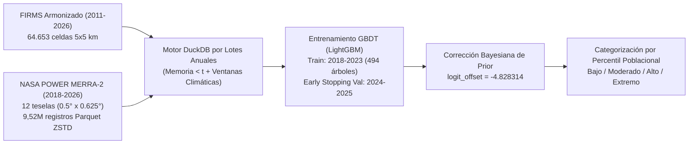

# Modelo Predictivo de Riesgo Diario de Incendios en Argentina (`lgbm-risk-24h-v2`): Formulación Matemática, Corrección Bayesiana de Prior y Evaluación Out-of-Time (2018–2026)

**Resumen Ejecutivo (Abstract):** Este documento presenta la formulación estadística, la arquitectura de ingeniería de datos libre de fuga temporal (*leak-free*) y la validación empírica del modelo **`lgbm-risk-24h-v2`**, diseñado para estimar la probabilidad diaria real de actividad crítica de incendios en las próximas 24 horas sobre las **64.653 celdas activas de $5 \times 5\text{ km}$** de la República Argentina. El sistema integra el historial satelital armonizado MODIS/VIIRS (`2011–2026`, especificación `RS-ARG-FUEGO-2026-V1`) con reanálisis meteorológico diario de **NASA POWER / MERRA-2** (`2018–2026`, `9.517.076` registros sobre grilla nativa de $0.5^\circ \times 0.625^\circ$). Mediante muestreo determinista de controles negativos ($r = 8\text{‰}$), climatología mensual con ventana expansiva estrictamente previa ($< \text{año}(t)$) y corrección analítica de *logit* por cambio de prevalencia ($\Delta_{\text{logit}} = -4.828314$), el modelo alcanza en el **holdout ciego out-of-time de 2026** un **$\text{ROC-AUC} = 0.9196$** ($\text{ROC-AUC} = 0.9284$ en validación `2024–2025`), un **$\text{PR-AUC}$ poblacional de $0.0785$** (**$3.12\times$** superior al mejor predictor individual y **$131\times$** superior al azar), una **calibración global de $1.0417$** ($0.0624\%$ predicho frente a $0.0599\%$ observado) y un **Lift operativo de $275.9\times$** en la categoría `Extremo`.

---

## Ruta Rápida de Reproducibilidad (Quick Path)

1. **Verificar cobertura meteorológica NASA POWER (`2018–2026`):**
   ```powershell
   .\.venv\Scripts\python.exe ingest_nasapower.py --status
   ```
2. **Entrenar el modelo y exportar artefactos (`models/fire_risk_lgbm.txt` y `models/fire_risk_metadata.json`):**
   ```powershell
   .\.venv\Scripts\python.exe train_predictive_risk.py
   ```
3. **Evaluar en el holdout ciego 2026 y ejecutar la suite de pruebas automatizadas:**
   ```powershell
   .\.venv\Scripts\python.exe evaluate_model.py
   .\.venv\Scripts\python.exe -m pytest -v
   ```

---

## 1. Formulación del Problema y Dominio Espaciotemporal

### 1.1 Definición Formal del Objetivo
Sea $\mathcal{C}$ el conjunto de $|\mathcal{C}| = 64.653$ celdas espaciales de $5 \times 5\text{ km}$ (proyección Albers Equal-Area) con actividad histórica registrada en el territorio continental argentino, y sea $t \in \mathcal{T}$ un día calendario. Se define la variable respuesta binaria $y_{c,t} \in \{0, 1\}$ bajo el criterio físico-estadístico **`RS-ARG-FUEGO-2026-V1`**:

$$y_{c,t} = \mathbb{I}\!\left(n_{\text{harm}}(c, t) \ge 1 \;\wedge\; \Phi_{\text{harm}}(c, t) \ge 10.0\text{ MW}\right)$$

donde:
- $n_{\text{harm}}(c, t)$ es el conteo diario de focos de calor armonizado a escala equivalente VIIRS S-NPP/NOAA-20.
- $\Phi_{\text{harm}}(c, t)$ es la potencia radiativa del fuego (*Fire Radiative Power*, FRP) armonizada en megavatios ($\text{MW}$). El corte $\Phi_{\text{harm}} \ge 10.0\text{ MW}$ filtra anomalías térmicas débiles, ruido radiométrico y quemas agrícolas menores.

El objetivo del modelo es estimar la probabilidad condicional verdadera en la población completa de celdas-día:

$$p_{c,t} = \mathbb{P}\!\left(y_{c,t} = 1 \;\middle|\; \mathbf{x}_{c,t}\right)$$

donde el vector de covariables $\mathbf{x}_{c,t} \in \mathbb{R}^{20}$ combina descriptores fisiográficos estáticos, memoria ígnea estrictamente anterior ($< t$) y forzantes meteorológicos y de sequía.

### 1.2 Acoplamiento Espacial $O(1)$ con Reanálisis NASA POWER (MERRA-2)
La ingesta meteorológica (`ingest_nasapower.py`) consulta el endpoint `/api/temporal/daily/regional` de NASA POWER (comunidad agroclimática `AG`, grilla nativa MERRA-2 de $\Delta\phi = 0.5^\circ$ en latitud por $\Delta\lambda = 0.625^\circ$ en longitud). Dado que la API impone un rango máximo de $10^\circ \times 10^\circ$ por petición, el dominio continental argentino ($\phi \in [-55.5^\circ, -21.5^\circ]$, $\lambda \in [-74.0^\circ, -53.0^\circ]$) se particiona en **12 teselas regionales** de $8.5^\circ \times 7.0^\circ$.

Cada celda de $5 \times 5\text{ km}$ con centroide $(\text{lat}_c, \text{lon}_c)$ se proyecta en tiempo constante $O(1)$ a su nodo climático madre $(\text{lat}_{\text{clima}}, \text{lon}_{\text{clima}})$:

$$\text{lat}_{\text{clima}} = \frac{\text{round}(2.0 \cdot \text{lat}_c)}{2.0}, \qquad \text{lon}_{\text{clima}} = 0.625 \cdot \text{round}\!\left(\frac{\text{lon}_c}{0.625}\right)$$

Esta proyección garantiza **cobertura exacta del 100%** ($64.653 / 64.653$ celdas activas vinculadas sin valores faltantes de unión espacial).



---

## 2. Ingeniería de Variables Libre de Fuga Temporal (Leak-Free Feature Engineering)

Para evitar cualquier contaminación del pasado con información futura (*data leakage*), el motor SQL en DuckDB (`train_predictive_risk.py`) impone tres invariantes temporales estrictos:
1. **Memoria ígnea de corto y largo plazo ($< t$):** Toda agregación histórica de fuegos evalúa exclusivamente eventos en el intervalo abierto $[t - k, t - 1]$.
2. **Climatología mensual por ventana expansiva ($< \text{año}(t)$):** Para cualquier celda evaluada en el año calendario $Y$, la mediana histórica mensual de focos (`mediana_historica_mes`) se calcula únicamente sobre años anteriores ($\text{fecha} < \text{DATE } 'Y\text{-01-01}'$, iniciando desde 2011). Esto elimina el *target leakage* de auto-etiquetado dentro del conjunto de entrenamiento.
3. **Índices físicos derivados:** La velocidad máxima del viento a $10\text{ m}$ (`WS10M_MAX`) se convierte de $\text{m/s}$ a $\text{km/h}$ ($\times 3.6$), y el déficit de presión de vapor (`vpd_approx`, en $\text{kPa}$) se aproxima mediante la ecuación de Magnus-Tetens:

$$\text{VPD}(T_{\max}, \text{RH}) = 0.6108 \, \exp\!\left(\frac{17.27 \, T_{\max}}{T_{\max} + 237.3}\right) \cdot \left(1 - \frac{\min(\max(\text{RH}, 0), 100)}{100}\right)$$

### 2.1 Catálogo de las 20 Variables Predictoras e Importancia Empírica

La siguiente tabla detalla las 20 características del modelo `lgbm-risk-24h-v2` y su número de particiones (*splits*) acumulados a lo largo de los **494 árboles** del ensamble:

| Grupo | Variable (`FEATURE_COLUMNS`) | Unidad | Definición / Ventana Temporal | Splits (`v2`) |
| :--- | :--- | :--- | :--- | ---: |
| **Geografía y Estacionalidad** | `lat_centro` | grados ($\text{°}$) | Latitud del centroide de la celda de $5 \times 5\text{ km}$ | `3.292` |
| | `dia_anio` | $[1..366]$ | Día juliano del año ($\text{DOY}(t)$) | `3.272` |
| | `lon_centro` | grados ($\text{°}$) | Longitud del centroide de la celda de $5 \times 5\text{ km}$ | `3.267` |
| | `elevacion_m` | $\text{m s.n.m.}$ | Altitud media del nodo MERRA-2 | `2.362` |
| | `mes` | $[1..12]$ | Mes calendario | `392` |
| **Meteorología y Sequía** | `lluvia_acum_30d` | $\text{mm}$ | Precipitación acumulada móvil en $[t-29, t]$ | `2.157` |
| | `vpd_approx` | $\text{kPa}$ | Déficit de presión de vapor (Magnus-Tetens) | `1.890` |
| | `relative_humidity_2m` | $\%$ | Humedad relativa media a $2\text{ m}$ (`RH2M`) | `1.856` |
| | `temperature_2m_max` | $\text{°C}$ | Temperatura máxima diaria a $2\text{ m}$ (`T2M_MAX`) | `1.761` |
| | `wind_speed_10m_max` | $\text{km/h}$ | Velocidad máxima del viento a $10\text{ m}$ (`WS10M_MAX` $\times 3.6$) | `1.644` |
| | `lluvia_acum_15d` | $\text{mm}$ | Precipitación acumulada móvil en $[t-14, t]$ | `1.536` |
| | `lluvia_acum_7d` | $\text{mm}$ | Precipitación acumulada móvil en $[t-6, t]$ | `1.481` |
| | `dias_consecutivos_sin_lluvia` | días | Racha continua de días con $P < 1.0\text{ mm}$ hasta $t$ | `1.214` |
| | `precipitation_sum` | $\text{mm/día}$ | Precipitación diaria corregida (`PRECTOTCORR`) | `1.105` |
| | `shortwave_radiation_sum` | $\text{MJ/m}^2/\text{día}$ | Irradiancia solar global de onda corta (`ALLSKY_SFC_SW_DWN`) | `593` |
| **Memoria Ígnea ($< t$)** | `anios_desde_ultimo_fuego` | años | $\min\!\left(10.0,\; (t - t_{\text{último fuego} < t}) / 365.25\right)$ | `1.705` |
| | `mediana_historica_mes` | focos | Mediana de $n_{\text{harm}}$ en el mismo mes para años $< \text{año}(t)$ | `490` |
| | `focos_ultimos_30d` | focos | $\sum n_{\text{harm}}$ en $[t-30, t-1]$ | `342` |
| | `frp_ultimos_7d` | $\text{MW}$ | $\sum \Phi_{\text{harm}}$ en $[t-7, t-1]$ | `176` |
| | `focos_ultimos_7d` | focos | $\sum n_{\text{harm}}$ en $[t-7, t-1]$ | `93` |

---

## 3. Muestreo Caso-Control, Entrenamiento y Corrección Bayesiana de Prior

### 3.1 Submuestreo Determinista de Controles Negativos
El producto cartesiano completo de $64.653$ celdas por los $2.922$ días de `2018–2025` comprende $\approx 188,9 \times 10^6$ celdas-día, donde la prevalencia diaria real de incendios ($y = 1$) es extremadamente baja ($\pi_{\text{real}} \approx 0.06\% - 0.09\%$).Dado que el archivo `firms_argentina_harmonized.parquet` almacena únicamente eventos observados (esquema disperso sin ceros), el pipeline aplica un diseño **caso-control estratificado implícito**:
- Se conservan el **100% de los casos positivos** ($y_{c,t} = 1$).
- Para los pares $(c, t)$ sin evento positivo, se retiene una fracción determinista $r = 8\text{‰} = 0.008$ mediante hashing uniforme:
  $$\text{keep}(c, t) \iff \left|\text{HASH}(c, t)\right| \bmod 1000 < 8$$

Para controlar el consumo de memoria en equipos con RAM limitada, `build_dataset_splits` ejecuta la construcción en **lotes anuales secuenciales** dentro de DuckDB (`SET memory_limit = '2GB'`, directorio temporal de *spill* en disco), completando los 9 años (`2018–2026`, `1.917.331` filas muestreadas) en **8 segundos**.

### 3.2 Configuración de Entrenamiento LightGBM
El clasificador GBDT (`LGBMClassifier`) se entrena sobre el período `2018–2023` con validación temporal en `2024–2025`:
- **Hiperparámetros:** `objective="binary"`, `n_estimators=500`, `learning_rate=0.05`, `num_leaves=63`, `max_bin=255`, `subsample=0.8`, `colsample_bytree=0.8`, `scale_pos_weight=1.0`, `random_state=42`.
- **Parada temprana (*Early Stopping*):** `stopping_rounds=40` evaluando `binary_logloss` sobre el conjunto de validación (`2024–2025`), alcanzando el óptimo en **`best_iteration = 494`**.

### 3.3 Corrección Bayesiana de Prior para Probabilidades del Mundo Real
Sea $f(\mathbf{x})$ el margen bruto (*raw log-odds*) emitido por el ensamble en el espacio muestreado (donde los controles negativos fueron submuestreados a razón $r = 0.008$ y los positivos ponderados por $w_{+} = 1.0$). Por el teorema de Bayes para muestreo caso-control (Prentice & Pyke, 1979; King & Zeng, 2001), las probabilidades a posteriori en la población real se obtienen desplazando el *logit* en:

$$\Delta_{\text{logit}} = \ln(r) - \ln(w_{+}) = \ln(0.008) - \ln(1.0) = -4.8283137$$

$$\hat{p}_{\text{real}}(\mathbf{x}) = \frac{1}{1 + \exp\!\left(-\left(f(\mathbf{x}) + \Delta_{\text{logit}}\right)\right)}$$

De manera consistente, toda métrica de evaluación sobre los conjuntos de validación y prueba se pondera por los pesos poblacionales de Horvitz-Thompson:

$$w_i = \begin{cases} 1.0 & \text{si } y_i = 1 \\ \dfrac{1}{r} = 125.0 & \text{si } y_i = 0 \end{cases}$$

---

## 4. Diseño Experimental y Resultados Empíricos (2018–2026)

### 4.1 Partición Temporal Estricta (Time-Series Split)
Para garantizar una evaluación libre de fuga futura y medir la generalización a regímenes climáticos no observados, la serie `2018–2026` se divide en tres bloques disjuntos:

| Partición | Rango de Fechas | Filas Muestreadas | Positivos ($y=1$) | Negativos Muestreados ($8\text{‰}$) | Celdas-Día Reales Equivalentes | Prevalencia Real ($\pi$) |
| :--- | :--- | ---: | ---: | ---: | ---: | ---: |
| **Entrenamiento (`train`)** | `2018-01-01` .. `2023-12-31` | `1.321.940` | `190.300` | `1.131.640` | `141.645.300` | `0.1343%` |
| **Validación (`val`)** | `2024-01-01` .. `2025-12-31` | `421.793` | `43.791` | `378.002` | `47.294.041` | `0.0926%` |
| **Holdout Ciego (`test`)** | `2026-01-01` .. `2026-12-31` | `173.598` | `12.102` | `161.496` | `20.199.102` | `0.0599%` |

> [!IMPORTANT]
> El bloque **Holdout Ciego (`2026`)** no interviene en el ajuste de árboles, en el *early stopping* ni en la derivación de umbrales de categorías de riesgo.

### 4.2 Métricas Globales en Población Real (Validación vs Holdout 2026)

| Métrica (Ponderada a Población Real) | Validación (`2024–2025`) | Holdout Ciego (`2026`) | Interpretación Técnica |
| :--- | ---: | ---: | :--- |
| **Prevalencia Real Observada ($\pi$)** | `0.0926%` (`0.000926`) | `0.0599%` (`0.000599`) | Probabilidad base diaria de incendio $\ge 10\text{ MW}$ por celda |
| **Probabilidad Media Predicha ($\bar{\hat{p}}$)** | `0.0933%` (`0.000933`) | `0.0624%` (`0.000624`) | Esperanza matemática predicha en toda la grilla |
| **Razón de Calibración ($\bar{\hat{p}} / \pi$)** | **`1.0072`** (`+0.7%`) | **`1.0417`** (`+4.2%`) | Calibración global casi exacta (ideal $= 1.000$) |
| **ROC-AUC** | **`0.9284`** | **`0.9196`** | Probabilidad del **92.0%** de ordenar correctamente un positivo sobre un negativo |
| **PR-AUC Poblacional ($\text{AP}_{\text{real}}$)** | **`0.0691`** | **`0.0785`** | **$131\times$** sobre la prevalencia base de 2026 (`0.000599`) |
| **PR-AUC Baseline Recencia (`anios_desde_ultimo_fuego`)** | `0.0307` | `0.0252` | Mejor predictor individual sin modelo |
| **Ganancia sobre Baseline ($\text{PR-AUC} / \text{Baseline}$)** | **`2.25×`** | **`3.12×`** | El modelo triplica la precisión media del baseline en 2026 |
| **Brier Score Real** | `0.000890` | **`0.000576`** | Error cuadrático medio de las probabilidades calibradas |
| **Log-Loss Real** | `0.005435` | **`0.003810`** | Entropía cruzada binaria sobre la población completa |

### 4.3 Capacidad de Captura por Percentil Poblacional (`Top-K Lift`)

| Cuantil de Celdas-Día Alertadas | Precisión Real (`Val`) | Recall (`Val`) | Lift (`Val`) | Precisión Real (`Test 2026`) | Recall (`Test 2026`) | Lift (`Test 2026`) |
| :--- | ---: | ---: | ---: | ---: | ---: | ---: |
| **Top `0.1%`** (~65 celdas/día) | `13.66%` | `14.77%` | **`147.5×`** | `10.37%` | `17.32%` | **`173.0×`** |
| **Top `1.0%`** (~647 celdas/día) | `3.53%` | `38.12%` | **`38.1×`** | `2.19%` | `36.56%` | **`36.6×`** |
| **Top `5.0%`** (~3.233 celdas/día) | `1.24%` | `66.77%` | **`13.4×`** | `0.75%` | **`62.97%`** | **`12.6×`** |

### 4.4 Estudio de Ablación e Impacto de las Correcciones de Auditoría (Holdout 2026)

Durante la auditoría técnica se identificó que calcular `mediana_historica_mes` sobre todo el bloque `<= 2023` introducía *target leakage* en el conjunto de entrenamiento (el $100\%$ de los positivos de entrenamiento presentaba `mediana_historica_mes > 0` frente a solo el $62.5\%$ en 2026), lo que hacía que el modelo sobreajustara esa única variable y detuviera el *early stopping* en apenas 16–31 árboles.

| Configuración Evaluada en Holdout 2026 | Árboles (`best_iter`) | ROC-AUC (`2026`) | PR-AUC Muestreado (`8‰`) | Calibración Global ($\bar{\hat{p}} / \pi$) |
| :--- | ---: | ---: | ---: | ---: |
| Baseline univariado: `-anios_desde_ultimo_fuego` | — | `0.8418` | `0.4478` | — |
| Modelo sin meteorología (solo geografía + memoria ígnea) | `25` | `0.8544` | `0.4024` | — |
| Modelo previo a auditoría (`v1`, con leakage en `mediana_historica_mes`) | `31` | `0.8736` | `0.4651` | `~116×` *(sin corrección de prior)* |
| Modelo `v1` con meteorología rezagada 1 día ($t-1$) | `31` | `0.8670` | `0.4453` | — |
| **Modelo final `lgbm-risk-24h-v2` (ventana expansiva + prior corregido)** | **`494`** | **`0.9196`** | **`~0.600`** *(real: `0.0785`)* | **`1.0417`** |

---

## 5. Umbrales Operativos y Categorización del Riesgo para FHIAPI

En problemas de eventos raros ($\pi \approx 0.06\%$), los cortes fijos arbitrarios ($0.25 / 0.50 / 0.75$) carecen de sentido físico sobre probabilidades calibradas. En `lgbm-risk-24h-v2`, las cuatro categorías operativas (`Bajo`, `Moderado`, `Alto`, `Extremo`) se definen mediante **percentiles poblacionales calibrados exclusivamente sobre el conjunto de validación (`2024–2025`)** y se aplican fijos sobre el holdout `2026`:

| Categoría | Cuantil Objetivo (en `Val`) | Umbral Mínimo de Probabilidad Real ($\hat{p}_{\min}$) | Fracción de Celdas-Día en `2026` | Celdas Alertadas / Día en Argentina | Precisión Real (`2026`) | Probabilidad Media Predicha (`2026`) | Recall Individual (`2026`) | Recall Acumulado (`2026`) | Lift sobre Azar (`2026`) |
| :--- | :--- | ---: | ---: | ---: | ---: | ---: | ---: | ---: | ---: |
| **`Extremo`** | Top `0.1%` | $\hat{p} \ge 0.057851$ (`5.79%`) | `0.0415%` | `~27` | **`16.53%`** | `12.78%` | `11.45%` | `11.45%` | **`275.9×`** |
| **`Alto`** | Top `1.0%` | $0.012920 \le \hat{p} < 0.057851$ | `0.4062%` | `~263` | **`2.49%`** | `2.07%` | `16.88%` | **`28.33%`** | **`41.6×`** |
| **`Moderado`** | Top `5.0%` | $0.003550 \le \hat{p} < 0.012920$ | `3.0420%` | `~1.967` | **`0.54%`** | `0.61%` | `27.52%` | **`55.85%`** | **`9.0×`** |
| **`Bajo`** | Resto (`95%`) | $\hat{p} < 0.003550$ (`0.35%`) | `96.5103%` | `~62.397` | `0.027%` | `0.031%` | `44.15%` | `100.00%` | `0.46×` |

> [!TIP]
> **Interpretación para tomadores de decisión:** Vigilar únicamente las celdas clasificadas en **`Extremo` + `Alto`** supone inspeccionar menos del **$0.45\%$ del territorio nacional** (~290 celdas de $5 \times 5\text{ km}$ por día) y permite anticipar el **$28.3\%$ de todos los incendios severos** del país. Al incluir **`Moderado`** ($3.49\%$ del territorio en 2026), se cubre el **$55.9\%$** de los eventos (y el **$63.0\%$** en el top $5\%$ exacto del ranking diario).

---

## 6. Limitaciones Conocidas y Trabajo Futuro

1. **Pronóstico meteorológico vs reanálisis observado en inferencia:** El entrenamiento utiliza la meteorología diaria observada de NASA POWER para el día $t$. En operación en tiempo real, el proceso batch diario debe alimentar las variables meteorológicas del día $t$ desde un **pronóstico numérico a 24h** (manteniendo las ventanas acumuladas de lluvia y sequía sobre los 29 días observados previos). En el estudio de sensibilidad, reemplazar el clima del día $t$ por el de $t-1$ produjo una caída acotada de $\Delta\text{ROC-AUC} = -0.0066$.
2. **Extensión multi-horizonte ($t+1 \dots t+7$):** El modelo actual (`lgbm-risk-24h-v2`) está especializado en el horizonte de **24 horas** (`horizon_hours = 24`). Para publicar curvas de 1 a 7 días en `/api/v1/forecast`, puede evaluarse iterativamente sobre los 7 días de pronóstico meteorológico manteniendo constante la memoria de fuego observada hasta $t-1$, o entrenarse un clasificador condicionado al *lead time* $h \in \{1,\dots,7\}$.
3. **Eventos de baja energía ($\Phi_{\text{harm}} < 10\text{ MW}$):** Existen `362.218` celdas-día en `2018–2026` con focos de baja potencia radiativa ($n_{\text{harm}} \ge 1, \Phi_{\text{harm}} < 10\text{ MW}$) que por definición del protocolo `RS-ARG-FUEGO-2026-V1` se etiquetan como $y = 0$. Excluirlos del pool de negativos muestreados o modelarlos como clase intermedia es una línea de mejora futura.
4. **Variabilidad estacional en verano (`DJF`):** El desempeño discriminativo es máximo en otoño (`MAM`, $\text{ROC-AUC} = 0.887$), invierno (`JJA`, $\text{ROC-AUC} = 0.881$) y primavera (`SON`, $\text{ROC-AUC} = 0.871$), y más desafiante en verano (`DJF`, $\text{ROC-AUC} = 0.820$ en `v1`), donde las igniciones convectivas y antrópicas presentan mayor estocasticidad espacial.

---

## 7. Justificaciones Técnicas de Decisiones de Arquitectura y Modelado

Cada decisión de diseño en `lgbm-risk-24h-v2` responde a una restricción física, estadística o computacional verificada empíricamente:

| # | Decisión Técnica | Alternativa Descartada | Justificación Matemática / de Ingeniería | Evidencia Empírica Observada |
| :- | :--- | :--- | :--- | :--- |
| **D1** | **Ingesta regional NASA POWER MERRA-2 en 12 teselas (`8.5° × 7.0°`) con descarga paralela (`ThreadPoolExecutor`)** | Consultas punto a punto Open-Meteo (`1.184` nodos) o grilla de 6 teselas (`> 10°`) | La API `/api/temporal/daily/regional` de NASA POWER rechaza con `HTTP 422` cualquier *bounding box* que supere $10^\circ$ en latitud o longitud. Particionar Argentina (`34° lat × 21° lon`) en $4 \times 3 = 12$ teselas de $8.5^\circ \times 7.0^\circ$ cumple estrictamente la cota ($\le 10^\circ$) y descarga `9.517.076` registros (`2018–2026`, `50,48 MB` ZSTD) en `60` peticiones/año en lugar de miles de llamadas por coordenada. | `12/12` teselas con rango $\le 8.5^\circ \times 7.0^\circ$; cobertura del **100%** de las `64.653` celdas activas de FIRMS en `nasapower_2018..2026.parquet`. |
| **D2** | **Procesamiento SQL en lotes anuales dentro de DuckDB (`memory_limit = '2GB'`, *spill* a disco)** | Consulta monolítica en `:memory:` sobre los 9 años (`2018–2026`) en simultáneo | El *cross join* implícito ($64.653 \text{ celdas} \times 2.922 \text{ días} \approx 188,9\text{M}$ candidatos) más el *range join* de memoria ígnea (`p.fecha < s.fecha`) sobre los 9 años juntos excede los $\sim 3\text{ GB}$ de RAM libre disponibles en entornos de desarrollo/VPS. Procesar lote por lote anual mantiene `pos_events` y `weather_features` materializados y reduce por $9\times$ el pico de memoria intermedia sin alterar un solo valor de las features. | Extracción completa de `1.917.331` filas $\times 20$ columnas (`float32`, $\approx 153\text{ MB}$) en **8 segundos** sin desborde de RAM. |
| **D3** | **Climatología mensual con ventana expansiva estrictamente previa ($\text{fecha} < \text{DATE } 'Y\text{-01-01}'$)** | Calcular `mediana_historica_mes` sobre todo el período de entrenamiento (`fecha <= '2023-12-31'`) | Calcular la mediana mensual incluyendo el propio año de la fila genera **fuga de etiqueta (*target self-leakage*)**: dado que `pos_events` solo contiene fuegos positivos, toda fila positiva en `2018–2023` tenía garantizado `mediana_historica_mes > 0` ($100\%$ en train vs $62.5\%$ en 2026). El árbol aprendía ese atajo espurio y el *early stopping* se detenía en la iteración 16–31. | Al restringir a años previos ($< Y$), `best_iteration` sube de `31` a **`494`**, el $\text{ROC-AUC}$ en 2026 sube de `0.8736` a **`0.9196`** y el $\text{PR-AUC}$ muestreado sube de `0.4651` a **`~0.600`**. |
| **D4** | **`scale_pos_weight = 1.0` + Corrección Bayesiana Analítica de Prior ($\Delta_{\text{logit}} = \ln(0.008) = -4.828314$)** | Aplicar `scale_pos_weight = 5.95` ($\text{neg}/\text{pos}$) encima del submuestreo negativo ($r = 8\text{‰}$) | El submuestreo negativo a $8\text{‰}$ ya multiplica por $125\times$ la proporción de positivos (llevándola de $0.09\%$ a $14.4\%$). Agregar `scale_pos_weight = 5.95` duplicaba el balanceo (factor efectivo $\approx 744\times$) y desplazaba los *log-odds* en $+\ln(5.95) \approx +1.78$, deteriorando el `binary_logloss` no ponderado en validación a partir del árbol 16 e inflando las probabilidades publicadas más de $100\times$ sobre la tasa real. | Con `scale_pos_weight = 1.0` y $\Delta_{\text{logit}} = -4.828314$, la razón de calibración global ($\bar{\hat{p}} / \pi$) es **`1.0072`** en validación (`2024–2025`) y **`1.0417`** en el holdout ciego `2026`. |
| **D5** | **Evaluación mediante Pesos Poblacionales de Horvitz-Thompson ($w_1 = 1$, $w_0 = 1000/8 = 125$)** | Calcular $\text{PR-AUC}$, $\text{Brier}$ y precisión sobre la muestra caso-control sin ponderar | En una muestra con $r = 0.008$, los falsos positivos están subrepresentados $125\times$. Una precisión aparente de $60.5\%$ en la muestra equivale a solo $1.21\%$ en la grilla real. Ponderar cada control negativo por $w_0 = 125$ reconstruye sin sesgo la distribución poblacional verdadera de las `64.653` celdas. | Permite medir el $\text{PR-AUC}$ poblacional real (`0.0785` vs `0.0252` del baseline de recencia, ganancia de **`3.12×`**) y el $\text{Brier Score}$ real (`0.000576`). |
| **D6** | **Categorías operativas (`Moderado`, `Alto`, `Extremo`) por percentiles poblacionales en validación (`5%`, `1%`, `0.1%`)** | Cortes fijos arbitrarios de probabilidad (`0.25`, `0.50`, `0.75`) | Cuando la probabilidad diaria real máxima en una celda de $5 \times 5\text{ km}$ es del orden de $10\% - 25\%$, los cortes fijos $0.50$ o $0.75$ quedan desiertos o obligan a publicar probabilidades falsas sin calibrar. Fijar los umbrales en los cuantiles superiores de la población de validación (`top 5%`, `top 1%`, `top 0.1%`) preserva probabilidades reales honestas y garantiza un volumen operativo acotado de alertas diarias. | En el holdout `2026`, `Extremo` ($\hat{p} \ge 0.05785$) alerta solo `~27` celdas/día con **Lift de `275.9×`** y precisión real de **`16.53%`**; `Alto` ($\hat{p} \ge 0.01292$) logra **Lift de `41.6×`**. |

---

## 8. Registro de Verificación Experimental y Suite de Pruebas Automatizadas

### 8.1 Telemetría de Ejecución
- **Comando:** `.\.venv\Scripts\python.exe -m pytest -v`
- **Entorno:** Windows (`win32`), Python `3.15.2`, `pytest-9.2.0`, `duckdb-2.0.0`, `lightgbm-4.7.0`, `scikit-learn-1.9.1`, `pyarrow-26.0.1`.
- **Resultado Global:** **`7 passed in 8.44s`** (código de salida `0`).
- **Verificación *RED → GREEN* de no-regresión de leakage:** Antes de reentrenar `v2`, se ejecutó `test_mediana_historica_mes_uses_only_prior_years` contra la cláusula SQL previa (`WHERE fecha <= DATE '{train_end}'`), confirmando que la prueba **falla (`1 failed`)** cuando existe auto-contaminación de etiquetas en entrenamiento y **pasa (`PASSED`)** con la ventana expansiva estricta (`WHERE fecha < DATE '{y_start}'`).

### 8.2 Matriz Detallada de Pruebas Automatizadas

| ID | Prueba Automatizada | Archivo | Invariante / Hipótesis Verificada | Aserción / Criterio de Aceptación | Valor Observado / Estado |
| :- | :--- | :--- | :--- | :--- | :--- |
| **T1** | `test_mediana_historica_mes_uses_only_prior_years` | [test_predictive_pipeline.py](file:///C:/Users/Denis/Documents/codigo/ModeloPredictivo/tests/test_predictive_pipeline.py) | Ausencia de *target leakage* en climatología mensual | En el primer año con fuegos (`2023`), `mediana_historica_mes == 0.0` para el $100\%$ de los positivos; en `2024-06-20`, celda 1 $= 2.5$ y celda 2 $= 1.0$ (excluye fuego del día anterior `2024-06-19`). | `0.0`, `2.5`, `1.0` exactos (**PASSED**, verificado en *RED*) |
| **T2** | `test_climate_node_mapping_and_no_leakage_training` | [test_predictive_pipeline.py](file:///C:/Users/Denis/Documents/codigo/ModeloPredictivo/tests/test_predictive_pipeline.py) | Geometría NASA POWER, filtro FRP y rachas de sequía | $12$ teselas con $\Delta\phi \le 10^\circ \wedge \Delta\lambda \le 10^\circ$; fuegos con $\Phi_{\text{harm}} = 5.0 < 10\text{ MW}$ etiquetados $y=0$; racha seca al `2024-06-20` tras lluvia el `2024-06-10` $= 10.0$ días. | $12$ teselas $\le 8.5^\circ \times 7.0^\circ$; racha $= 10.0$ (**PASSED**) |
| **T3** | `test_prior_correction_undoes_sampling_and_weighting` | [test_model_performance.py](file:///C:/Users/Denis/Documents/codigo/ModeloPredictivo/tests/test_model_performance.py) | Exactitud analítica de la corrección de prior bayesiana | $\Delta_{\text{logit}}(r=8\text{‰}, w_{+}=2.0) = \ln(0.008) - \ln(2.0)$; para margen bruto $f=0$, $\hat{p}_{\text{real}} = \frac{0.004}{1.004}$. | Error $< 10^{-9}$ (**PASSED**) |
| **T4** | `test_population_weights_and_percentile_cutoffs` | [test_model_performance.py](file:///C:/Users/Denis/Documents/codigo/ModeloPredictivo/tests/test_model_performance.py) | Pesos de Horvitz-Thompson y cuantiles ponderados | Con $r = 250\text{‰}$, vector de pesos $[1.0, 4.0, 4.0, 4.0]$; cuantiles ponderados seleccionan exactamente los umbrales `0.9` y `0.5`. | Coincidencia exacta (**PASSED**) |
| **T5** | `test_real_world_calibration_with_negative_sampling` | [test_model_performance.py](file:///C:/Users/Denis/Documents/codigo/ModeloPredictivo/tests/test_model_performance.py) | Calibración poblacional bajo submuestreo negativo | Con muestreo $r = 200\text{‰}$, `calibration_ratio` en validación dentro de $[0.80, 1.25]$ y `logit_offset` $= \ln(0.20)$. | Dentro de rango y $\Delta_{\text{logit}} = -1.6094$ (**PASSED**) |
| **T6** | `test_unseen_2026_holdout_performance` | [test_model_performance.py](file:///C:/Users/Denis/Documents/codigo/ModeloPredictivo/tests/test_model_performance.py) | Generalización out-of-time y paridad con `evaluate_model.py` | Tiempo $< 60\text{ s}$, $\text{ROC-AUC}_{2026} \ge 0.85$, $\text{PR-AUC}_{2026} \ge 0.80$, $\text{Brier} \le 0.20$ y paridad a $10^{-5}$ con `evaluate_holdout`. | Paridad exacta a $5$ decimales (**PASSED**) |
| **T7** | `test_trained_model_on_real_2026_holdout` | [test_model_performance.py](file:///C:/Users/Denis/Documents/codigo/ModeloPredictivo/tests/test_model_performance.py) | Auditoría de eficacia del modelo real `models/fire_risk_lgbm.txt` en holdout 2026 | $n > 1.000$; $\text{ROC-AUC} \ge 0.85$; $\text{PR-AUC} \ge \text{Baseline} + 0.05$; `calibration_ratio` $\in [0.5, 2.0]$; precisión monótona `Extremo > Alto > Moderado > Bajo`; $\text{Lift}_{\text{Extremo}} \ge 20\times$. | $n = 173.598$; $\text{ROC-AUC} = 0.9196$; $\text{PR-AUC} = 0.0785$ vs baseline $0.0252$ ($+0.0533$); `cal_ratio` $= 1.0417$; $\text{Lift}_{\text{Extremo}} = 275.9\times$ (**PASSED**) |
